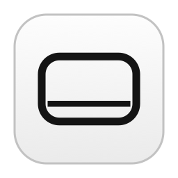

# MacClick



MacClick is an open-source macOS menu bar app that turns built-in trackpad gestures into mouse clicks and keyboard shortcuts. It uses Swift and AppKit and runs locally without third-party dependencies.

| Gesture | Default action |
| --- | --- |
| Three-finger tap or click | Middle mouse click |
| Three-finger swipe right | Control + Tab |
| Three-finger swipe left | Control + Shift + Tab |
| Four-finger tap or click | Command + W |

You can change each action, turn individual gestures off, or set MacClick to launch at login.

## Requirements

- Apple Silicon MacBook with a built-in trackpad
- macOS 27.2 or later, tested on 27.2
- Xcode 27.2 or later to build from source

MacClick uses a private macOS framework for raw trackpad contacts. See [trackpad compatibility](docs/Trackpad.md) for the API and distribution limits, as well as system gestures that can overlap with MacClick.

## Build from source

Open `MacClick.xcodeproj` and run the shared **MacClick** scheme, or build from the repository root.

```sh
export DEVELOPER_DIR=/Applications/Xcode.app/Contents/Developer
xcodebuild -project MacClick.xcodeproj -scheme MacClick \
  -configuration Release -destination 'platform=macOS,arch=arm64' \
  -derivedDataPath build build
```

Copy `build/Build/Products/Release/MacClick.app` to Applications and open that copy. The default build uses an ad hoc signature.

## First run

MacClick needs permission to send clicks and shortcuts. A download may also prompt for approval to open the app because the release uses an ad hoc signature and lacks Apple notarization.

| Step | What to do |
| --- | --- |
| 1. Install | Extract the [GitHub release archive](https://github.com/ilkerduran/MacClick/releases/latest) and move `MacClick.app` to **Applications**. |
| 2. Approve the app if prompted | Open MacClick. If macOS says it cannot verify the app, click **Done**. Go to **System Settings → Privacy & Security → Security**, choose **Open Anyway**, then confirm and authenticate if prompted. If the button is missing, try opening MacClick again. [Apple’s instructions](https://support.apple.com/guide/mac-help/mh40617/mac) |
| 3. Open the permission list | In the MacClick menu bar menu, choose **Open Settings → Settings → Open Privacy Settings**. This opens **System Settings → Privacy & Security → Device Control and Data Access**. |
| 4. Grant access | If MacClick is missing, click **+**, select `/Applications/MacClick.app`, and click **Open**. Turn on the switch next to MacClick. After replacing an ad hoc build, remove any stale MacClick entry and add the current Applications copy again. |
| 5. Relaunch MacClick | Choose **Quit MacClick** in the menu bar, then reopen MacClick from **Applications**. Relaunching applies the new grant when **Retry** does not. |
| 6. Check browser swipes | If a three-finger swipe changes tabs and also navigates browser history, go to **System Settings → Trackpad → More Gestures → Swipe between pages**. Choose the two-finger option or turn it **Off**. [Trackpad troubleshooting](docs/Trackpad.md#browser-history-changes-during-a-three-finger-swipe) |

MacClick uses the macOS permission to send its configured mouse clicks and shortcuts and to replace matching primary-button clicks. The click monitor covers only primary-button events. Shortcut recording only receives key events delivered to MacClick’s settings window. MacClick does not request Input Monitoring.

## Customize gestures

On the **Trackpad** page, select a gesture and choose **Middle Mouse Click** or **Keyboard Shortcut**. Use **Record Shortcut** to enter a key combination. **Restore Default** restores the selected action.

Use a row’s **Enabled** checkbox to disable that gesture or **Disable Gestures** in the menu to pause all gestures. Gestures pause while the settings window has keyboard focus. **Launch at Login** uses macOS login items and may require approval in **System Settings → General → Login Items & Extensions**.

If gestures stop responding, choose **Reload Gestures** in the menu bar to reconnect trackpad input. **Retry** in Settings does the same.

## Contribute

Use [GitHub Issues](https://github.com/ilkerduran/MacClick/issues) for bugs and feature requests. For trackpad bugs, include the Mac model, macOS version, MacClick build, gesture, and whether you used a light tap or physical click. Pull requests should include verification steps.

Use the other person’s language in direct conversation. Write code, documentation, repository contributions, and commit messages in English. MacClick’s interface is English for now. See the [contributor guide](AGENTS.md) for project conventions and test commands, and the [verification record](docs/Verification.md) for hardware checks and measured performance.

## Website

The static landing page is in [web/](web/). See the [hosting instructions](web/README.md) for GitHub Pages and custom domains.

## License

MacClick is licensed under the [Apache License, Version 2.0](LICENSE).
